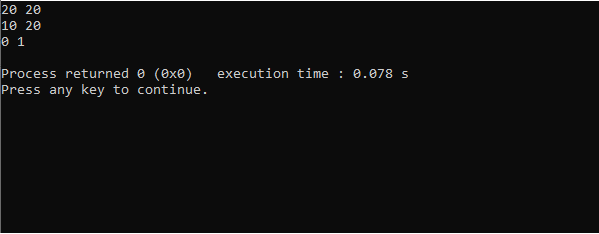
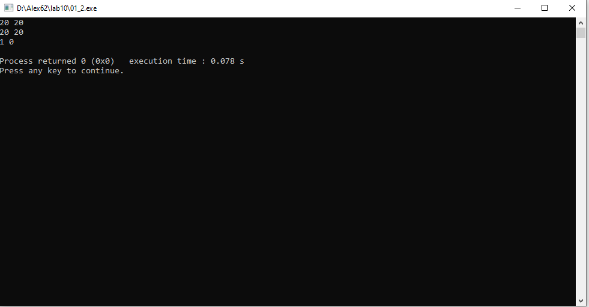

# Языки программирования
## Лабораторная работа 10

### Задание 1 **(2)**

*Рассмотрите следующие фрагменты программ. Запишите, что означают символы* **&** и  * *в каждом случае применения.*
```
int a = 10, b = 20;
int *p = &a , *q = &b;
p = q;
std::cout << *p <<' '<< *q << std::endl;
```
```
int a = 10, b = 20;
int *p = &a , *q = &b;
*p = *q;
std::cout << *p <<' '<< *q << std::endl;
```
*Чем различаются присваивания в третьей строке? Что можно вывести,
чтобы показать различия?*

*Примеры программ сохраните в папке с номером задания. Скриншоты работы прикрепите к отчету.*

#### Решение
При p=q копируется адрес: p начинает указывать на b, a остаётся 10, вывод 20 20. При *p=*q копируется значение: a становится 20, p остаётся указывать на a, вывод тоже 20 20. Различие видно по a, b и сравнению p с &a и &b. Символ & означает взятие адреса, * в объявлении означает указатель, * в выражении означает разыменование.





### Задание 2 **(1)**

*Рассмотрим следующую программу.* 
```
double x[10];
for (int i = 0; i <10; i++)
    std::cout << &x[i] << std::endl;
```
*Что она выводит? Измените
вывод так, чтобы адреса выводились в десятичной системе счисления.
Объясните почему числа составляют арифметическую прогрессию с
определенным шагом.*

*Записанную программу сохраните в папке с номером задания.*
*Скриншоты работы прикрепите к отчету.*

#### Решение 
Программа выводит адреса элементов массива. Элементы double лежат подряд, sizeof(double) равен 8, поэтому каждый следующий адрес больше на 8. Для десятичного вывода адрес преобразуется в size_t через reinterpret_cast.

### Задание 3 **(2)**

*Токен* **«*»** *в языке C++ может использоваться в трех различных
случаях. Аналогично токен* **«&»** *также может использоваться в трех
случаях. Приведите пример одной программы в которой они были бы
использованы во всех случаях.*

*Записанную программу сохраните в папке с номером задания.*

#### Решение

У * три случая: описатель указателя, разыменование, умножение. У & три случая: взятие адреса, описатель ссылки, побитовое И.

### Задание 4 **(2)**

*Выпишите значения всех переменных, в том числе указателей,
после выполнения каждой инструкции программы. Объясните, что
происходит в результате выполнения каждой инструкции.*
```
unsigned a = 8, b = 3 ,c = 17;
unsigned *p = &a;
unsigned *q = &b;
*p += *q + c;
c = *q;
p = &c;
c += a;
*p += 10;
*q = *p;
q = p ;
*q += 10;
```

#### Решение

После всех инструкций получается a=28, b=41, c=51, указатели p и q указывают на c

### Задание 5 **(1)**

*Что сравнивается в приведенной ниже программе? Как можно
изменить первую строчку программы, чтобы результат тоже
изменился?*
```
int x = 1, y = 2;
int *p = &y, *q = &x;
if (p < q)
    std::cout << "Yes";
else
    std::cout << "No";
```

#### Решение 
Сравниваются адреса y и x, а не значения 2 и 1. Размещение переменных стандартом не регулируется, поэтому результат зависит от порядка объявления. В примере выводится Yes; если поменять порядок объявления, можно получить No. Надёжнее поменять инициализацию указателей.

### Задание 6 **(2)**

*Объясните работу следующей программы. Как изменится
результат, если тип* **double** *изменить на некоторый другой, например*
**int** *или* **char**?
```
double x = 0;
double *d = &x;
std::cout << reinterpret_cast<size_t>(d + 4) - reinterpret_cast<size_t>(d - 4) << std::endl;
```

#### Решение

При сложении указателя с числом адрес меняется на n*sizeof(type). Разность d+4 и d-4 для double равна 64. Для int будет 32, для char будет 8.

### Задание 7 **(2)**

*Объясните работу следующей программы. Как изменится
результат, если тип* **double** *изменить на некоторый другой, например*
**int** *или* **char**?
```
std::cout << reinterpret_cast <double*>(3000) - reinterpret_cast <double*>(2000) << std::endl;
```

#### Решение

Разность указателей равна разности адресов, делённой на sizeof(type). Для double получается 125, для int 250, для char 1000.

### Задание 8 **(2)**

*Что надо дописать в записанной ниже программе вместо многоточий, чтобы
она выводила все числа из массива* **a**? *Почему?*
```
int a[20];
for ( int i = 0; i < 20; i++)
    a[i] = i;
int *b=a + 8;
for (int i =...; i <...; i++)
    std::cout << b[i] <<' ';
```

#### Решение

b=a+8, а b[i] равно a[8+i]. Чтобы вывести a[0] до a[19], нужен цикл i от -8 до 11. Отрицательный индекс допустим, пока адрес остаётся внутри массива.

### Задание 9 **(2)**

*Что выводит следующая программа? Изменится ли результат если
изменить тип элементов массива?*

```
int a[10];
std::cout << &a[8] - &a[3] << std::endl;
```

#### Решение

Разность &a[8] и &a[3] равна 5. От типа элементов результат не зависит, потому что разность адресов делится на sizeof(type).

### Задание 10 **(1)**

*Есть ли разница между инициализацией* **p** и **q** *в следующей программе? Обоснуйте ответ.*
```
int x [10]={1, 2, 3, 4, 5, 6, 7, 8, 9, 10};
int *p = x + 5;
int *q = &x[5];
```

#### Решение

x+5 и &x[5] дают одно и то же. Оба указателя имеют тип int* и указывают на шестой элемент со значением 6.

### Задание 11 **(3)**

*Указатели можно использовать для итерации по массивам.
Напишите программу, которая найдет сумму элементов массива,
используя указатели. В начале цикла указатель требуется установить
на начало массива, в конце каждой итерации смещать его к
следующему элементу массива через инкремент. Для выхода из цикла
надо проверять, что указатель дошел до конца массива.*
```
int x [10]={1, 2, 3, 4, 5, 6, 7, 8, 9, 10};
int s = 0;
for (int *p = ...; ...; ...)
    s += ...
std::cout << s;
```

*Записанную программу сохраните в папке с номером задания.*

#### Решение

. Цикл идёт от p=x до p=x+10 с шагом p++. В теле суммируется *p. Сумма элементов от 1 до 10 равна 55.

## Дополнительные задания

### Задание 1 **(3)**

*Запишите программу на С++, в которой будет создаваться двумерный массив* **x[10][10]**. *Выведите адреса элементов массива и нарисуйте, как элементы расположены в памяти.*

#### Решение

Массив x[10][10] занимает непрерывный блок. Шаг между соседними элементами строки 4 байта, шаг между началами строк 40 байт. Конец одной строки сразу переходит в начало следующей.

### Задание 2 **(3)**

*Запишите программу на С++, в которой будет создаваться двумерный массив* **x[10][10]**. *Проверьте, что произойдет при различных выходах за границы массива. Напишите программы для демонстрации и поясните
их работу.* 

#### Решение

x[0][10] соответствует x[1][0], x[0][25] соответствует x[2][5], x[3][-1] соответствует x[2][9]. Выход за границы всего массива читает чужую память и является неопределённым поведением. Формально выход за границу строки тоже неопределённое поведение, хотя на практике часто работает как описано.

### Задание 3 **(6)**
*Напишите пример программы, которая продемонстрирует неопределенное поведение при выходе за границу одномерного массива. Например, чтобы программа зависла, хотя по алгоритму такого не должно произойти

#### Решение

В структуре счётчик i лежит сразу после массива a. Ошибка <= вместо < приводит к записи a[5]=0, которая попадает в i и обнуляет его. Цикл начинается заново и не завершается. Результат зависит от компилятора, проверять лучше с g++ -O0.

### Задание 4 **(8)**
*Изучите самостоятельно работу с динамической памятью. Напишите примеры программ, демонстрирующие особенности работы (например, перемещение при расширении) и возможные ошибки при работе с памятью.* 

#### Решение

Для динамической памяти нужны парные new и delete, new[] и delete[]. vector::push_back и realloc могут перенести данные, после чего старые указатели становятся висячими. Типичные ошибки: утечка, двойное освобождение, использование после освобождения, выход за границу, delete вместо delete[], висячий указатель после расширения. Диагностика: g++ -g -fsanitize=address.
